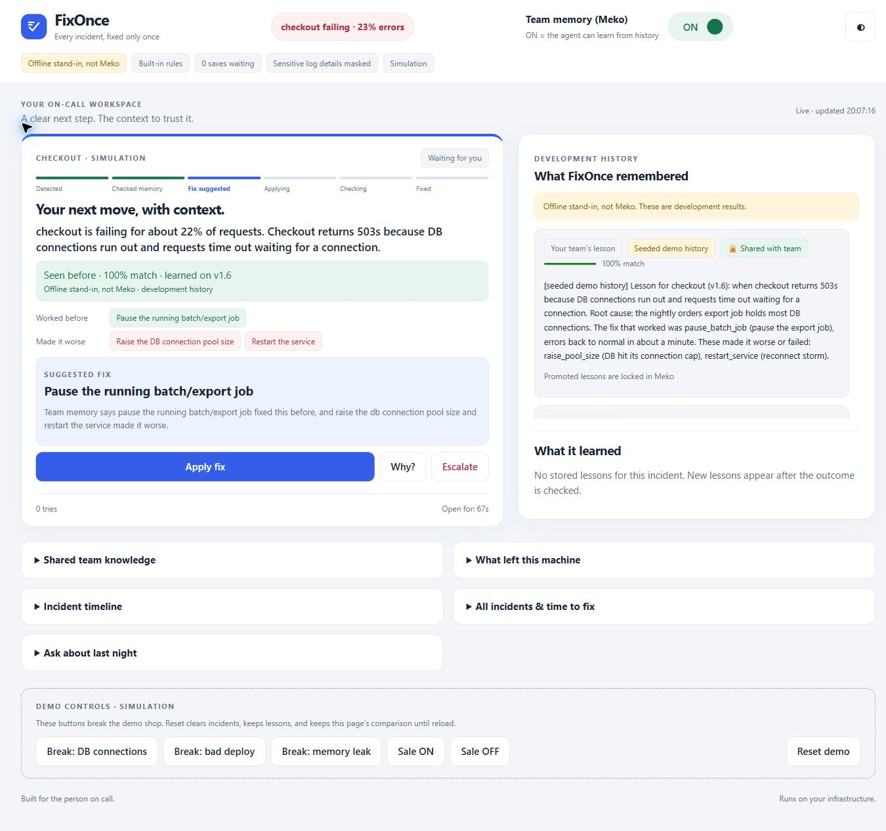
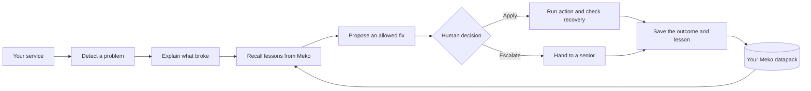

# FixOnce

**Every incident, fixed only once.** An on-call teammate that remembers.

At 3 AM, the junior engineer on call should not have to rediscover yesterday's fix. FixOnce
shows what happened last time, what worked, what made it worse, and a suggested action to approve.
Lessons live in [Meko](https://mekodata.ai), ready for the next incident and the next shift.

Built at **hackCBS 9.0 · Meko challenge · Track A**.

[Quick start](#quick-start) · [Five-minute demo](#five-minute-demo) · [How Meko is used](#how-meko-is-used-and-why) · [Use your own service](#use-your-own-service) · [Meko feature proposal](docs/feature-proposal.md)



*Captured from the local simulation using the clearly labelled offline stand-in, not real Meko.*
[Phone view](docs/ui/phone-light.png) · [Dark theme](docs/ui/laptop-dark.png) · [OFF vs ON comparison](docs/ui/comparison.png)

## Why it exists

Repeated outages often come with a familiar problem: the fix lives in someone's head or an old
chat thread. The person on call starts from zero, including repeating steps that made things worse.
FixOnce puts that experience beside the next decision, with the recalled text visible and a human
in control of applying the fix.

**It runs on your infrastructure.** FixOnce is a Python package with a local web page, not a
FixOnce-hosted service. You choose the watched service, Meko datapack, Gemini key and optional
notification destination. Log messages are masked before agents read them; see [Data and privacy](#data-and-privacy).

## The difference memory makes

The same **DB connections simulation**, observed in our offline smoke test:

| | Memory OFF | Memory ON |
| --- | --- | --- |
| Context | No incident history | Seeded development lesson recalled |
| Action | Raises the connection pool, restarts, then adds replicas | Pauses the export job |
| Tries | 3 unsuccessful attempts | 1 successful attempt |
| Outcome | Handed to a senior | Fixed |

This is a reproducible development scenario, not a production benchmark or a real-Meko performance
claim. The real-Meko demo uses lessons returned by Meko. The page shows actual attempts and time to
fix; no example timings are filled in. Model-generated proposals may differ from the built-in rules.

## Quick start

Choose an offline walkthrough or a real-Meko demo. Both Docker paths need **Git and Docker Compose**
(with Docker Desktop running on Windows/macOS). Run these commands from a new clone; `cp` works in
bash and PowerShell. In an existing checkout, keep your current `.env` instead of overwriting it.

### Offline walkthrough — no keys

```bash
git clone https://github.com/visheshgupta0404/FixOnce.git
cd FixOnce
cp .env.example .env
docker compose up --build -d
```

Leave the API keys empty. Open [localhost:8000](http://localhost:8000). The page should say
**Offline stand-in, not Meko** and **Built-in rules**. Seeded history is loaded automatically in
offline demo mode. This mode is for development, not evidence of a live Meko integration.

### Real Meko + Gemini demo — five commands

```bash
git clone https://github.com/visheshgupta0404/FixOnce.git
cd FixOnce
cp .env.example .env
docker compose up --build -d
docker compose exec backend python -m fixonce.seed
```

**Before the fourth command**, edit `.env` and fill in:

| Setting | Value |
| --- | --- |
| `MEKO_API_KEY` | Your Meko API key |
| `MEKO_DATAPACK_ID` | A dedicated product/demo datapack; never the team's `fixonce-build` datapack |
| `GEMINI_API_KEY` | Your Gemini API key |

Seed once per demo datapack. It writes clearly marked **seeded demo history** into Meko; use a demo
datapack rather than seeding a real service's knowledge. Open [localhost:8000](http://localhost:8000)
and check for **Real Meko**, **Gemini**, and any fallback or pending-save warnings.
`GET /api/status` reports the running modes. Keep `.env` out of Git.

### Without Docker

Requires **Python 3.11+**. From the repository root, preferably inside a virtual environment:

```bash
python -m pip install "./backend[gemini]"
fixonce demo --env-file none
```

This runs the page, agents and simulated shop in one process. `--env-file none` skips the repository's
`.env`; it does **not** clear variables already exported in your shell. For an offline run, use a
shell without Meko, Gemini or webhook credentials configured. Use `fixonce demo` to read your `.env`.
If the `fixonce` command is not on PATH, use `python -m fixonce.cli demo --env-file none`.

## Five-minute demo

All Break and Sale controls are labelled **simulation** and only appear for a compatible demo target.

1. **Run without history.** Turn team memory **OFF**, choose **Break: DB connections**, and tap
   **Apply fix** each time a proposal appears. Wait for each check. With the built-in rules,
   three unsuccessful tries end in **Handed to a senior**.
2. **Run with history.** Press **Reset demo**, turn memory **ON**, and break DB connections again.
   Inspect the recalled lesson and the steps that made things worse. Apply the proposed fix and
   wait until the server confirms the result. Applying normally includes an approximately
   eight-second check; a healthy metric alone is not the final outcome.
3. **Compare the results.** The OFF vs ON strip pairs finished incidents with the same pattern
   observed by this page. Keep the page open between runs: Reset clears server incidents but keeps
   this page's comparison; reloading clears the comparison. Displayed times include time spent
   waiting for human approval.
4. **Review what was learned.** Wait for the new stored lesson. Tap **Correct**, edit inline and
   save. Then select **Fix held: share with team**. It appears in **Shared team knowledge** on the
   next refresh and becomes locked. To demonstrate **Forget**, use another fresh, unpromoted
   lesson; do not forget the lesson you intend to promote.
5. **Look for repeats.** When Meko returns enough matching past lessons, the orange repeat card
   shows the observed count, root cause and proposed permanent fix. Select **Create follow-up**
   to save that work in Meko. Open follow-ups remain visible on subsequent matching incidents;
   the quick fix and the permanent fix are separate decisions.
6. **Inspect the evidence.** Open **What left this machine** for destination counts, masking and
   request logs; inspect **Every Meko call** for operations and results. Ask **What happened last
   night?** to get a summary from the history available to this instance.

**Reset keeps lessons.** Wait for a lesson to finish saving before resetting. The reset script also
turns memory OFF by default; the page's Reset button leaves the switch as it was.

## How Meko is used (and why)

| Meko use | In FixOnce | Why |
| --- | --- | --- |
| Recall before reasoning | Recall calls `context_search` and `knowledgebase_search` before a fix proposal | Past fixes and failed steps inform the next decision |
| Extracted memories | Scribe saves an incident lesson with `memory_add` | The next shift needs the lesson, not a pile of logs |
| Promotion to shared knowledge | A human confirms the fix held, then `memory_promote` shares it | Verified lessons become team knowledge |
| Sharing across agents and users | Agents and teammates with datapack access can recall promoted lessons | Experience survives the handoff |
| Patterns across incidents | Recall counts matching past incident lessons and reads root causes; permanent-fix follow-ups are stored in Meko and recalled on a repeat | Repeated incidents should lead to fixing the cause, not just repeating a quick fix |
| Documents and decision traces | `artifact_put` stores postmortems; `conversation_add_message` records decisions | Engineers can inspect how a decision was made |

In real mode, the memory panel displays the text returned by Meko. Offline mode is explicitly
labelled as a stand-in. Seeded history is marked. Recalled items show their source and match
strength; a match is evidence to review, not a guarantee. Correct and Forget work on unpromoted
stored lessons; promoted lessons are locked by the current Meko integration.

Our [Meko feature proposal](docs/feature-proposal.md) describes the friction we encountered with
promoted knowledge and proposes revisions, retraction and version-aware recall.

## How it works



The fixer proposes only names from the configured action catalog. A human approves before an
action runs. Team rules can block an action; outdated recalled versions are flagged for review.

## Use your own service

Install from Git; the package is not published to PyPI yet:

```bash
python -m pip install "fixonce[gemini] @ git+https://github.com/visheshgupta0404/FixOnce.git#subdirectory=backend"
fixonce serve --target http://payments.internal:9000
```

Your service or sidecar provides four routes: `GET /metrics`, `GET /logs`, `GET /deploys`, and
`POST /actions/{name}`. Alternatively, supply a Python adapter:

```bash
fixonce serve --target examples.payments_target:Payments
```

Run that example from the repo root; see [the complete adapter](examples/payments_target.py).
You can also embed the page and API in your own Python application:

```python
import fixonce
from examples.payments_target import Payments

app = fixonce.create_app(target=Payments())  # FastAPI app; serve with an ASGI server
```

`serve` disables demo mode by default. Run one instance per target. The [package guide](docs/package.md)
has the full target contract, action catalog, team rules and settings.

## Data and privacy

| Data | Destination |
| --- | --- |
| Service metrics, logs and deploys | Read from your configured target. Supported sensitive patterns in log `msg` fields are masked in-process before agents read them when `FIXONCE_REDACT=true` (default) |
| Lessons, postmortems and decision traces | Your configured Meko datapack, using your key, when memory is enabled |
| Model prompts | Gemini using your key, when configured; otherwise built-in rules run locally |
| Incident notifications | Your optional `FIXONCE_WEBHOOK_URL`, including incident summaries and outcomes |
| Page assets | Served by your FixOnce instance; no CDN, external fonts or outside images |

There is no FixOnce-operated backend or package telemetry. **Self-hosted does not mean all data stays
local:** configured Meko, Gemini, HTTP targets and webhooks can be external destinations. Turning
Meko OFF disables memory use; it does not disable Gemini or notifications.

Masking covers supported email, IP, secret, card and phone patterns in log messages. It is not a
guarantee that arbitrary incident text contains no sensitive data. Review your adapter, inputs and
destinations before connecting a real service. The demo's customer emails and IPs are made up.

The **What left this machine** panel lists instrumented Meko, Gemini and webhook requests, masking
counts and the last masked log line. It is an application audit view, not a network packet capture.
Optional alerts can be signed using `FIXONCE_WEBHOOK_SECRET`; see the
[n8n / WhatsApp integration guide](docs/n8n-whatsapp.md).

## Checks and troubleshooting

Run tests from `backend/`:

```bash
python -m pip install -e ".[dev]"
python -m pytest -q
```

With a demo already running, use bash (Git Bash on Windows) from the repo root:

```bash
bash scripts/demo_smoke.sh
bash scripts/demo_reset.sh
```

The smoke script changes demo state, runs OFF vs ON and prints `PASS` when the expected scenario
holds. Point it at a demo instance, not a real target. Both scripts accept `FIXONCE_URL`; reset
keeps lessons and defaults to memory OFF. For example in bash:
`FIXONCE_URL=http://localhost:8000 bash scripts/demo_reset.sh on`.

| Symptom | What to check |
| --- | --- |
| Page will not open | Confirm the process or containers are running. For Docker, inspect `docker compose ps` and `docker compose logs backend`. The page uses port 8000 |
| Offline label when real Meko was expected | Check `.env` key names and the product datapack ID; recreate containers after changing environment values (`docker compose up -d --force-recreate`) |
| Gemini unavailable warning | Inspect the warning details and configured model/key. Built-in rules may answer while Gemini is unavailable; the page reports the fallback |
| Saves waiting / memory unavailable | Check Meko connectivity and datapack access. Inspect the Meko call feed; wait for saves to finish before resetting |
| No matching history | Confirm you seeded the dedicated demo datapack once, memory is ON, and recall calls succeeded |
| Correct or Forget is missing | Promoted lessons are locked. Demonstrate those actions on a fresh lesson before promotion |
| First Docker build fails while downloading | Check the connection and retry the build. Download/build time depends on your machine and network |

Docker Compose exposes the page on port 8000 and binds the simulated shop's debug port 8001 to
localhost only. For deployment, the root [Dockerfile](Dockerfile) and [Render blueprint](render.yaml)
run the in-process demo shop. Configure credentials privately and check your hosting provider's
current settings before a demo.

## Current limits

- Incident history is in process memory: restarting loses incident records; Reset clears them.
  Real-mode lessons already saved to Meko remain there. Offline stand-in memory is lost on restart.
- The OFF/ON comparison is limited to finished incidents observed in the current browser session.
- Promoted lessons cannot be corrected or forgotten through the current integration.
- One target per process. Custom services need an adapter, allowed actions and suitable rules;
  the demo's built-in rules are not a general-purpose production runbook.
- Human approval and an allowed-action catalog do not establish that an action is safe for every
  service. Validate actions and access controls for your deployment.

## Code map

All runtime code ships in `backend/fixonce`:

| Path | Purpose |
| --- | --- |
| `target.py`, `redact.py` | Read the target and mask log messages |
| `agents/`, `orchestrator.py` | Triage, recall, detect recurrence, propose fixes, check outcomes and write lessons |
| `memory/`, `llm.py` | Meko connection and Gemini / built-in rules |
| `main.py`, `web/index.html` | API and the single-file on-call page |
| `demo/shop.py`, `cli.py` | Simulated shop and the `fixonce` command |

## Team and presentation

**Vedansh Mathur · Vishal Verma · Vishesh Gupta**

Demo video and slide links will be added when available.
